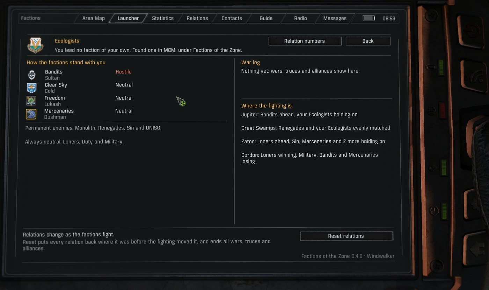
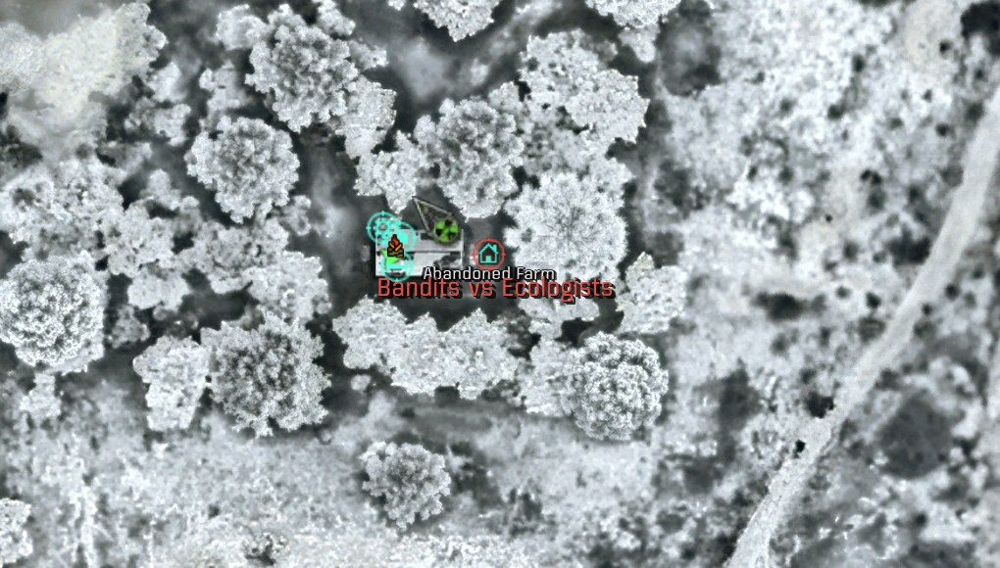
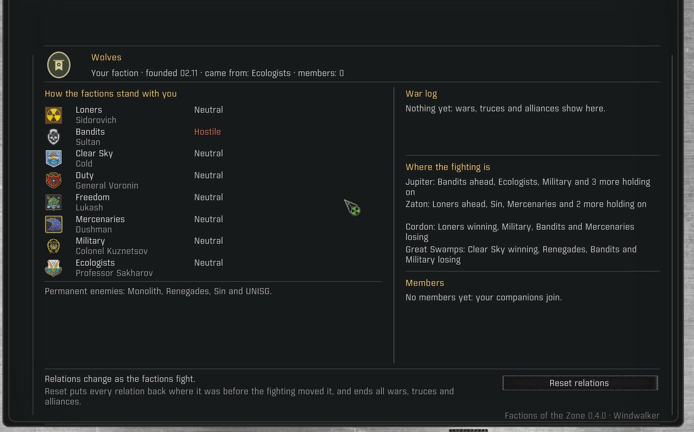
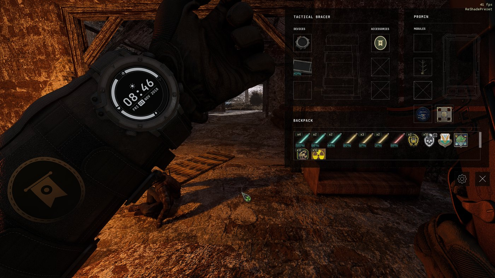
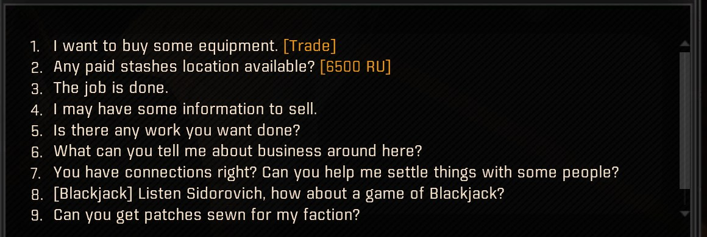
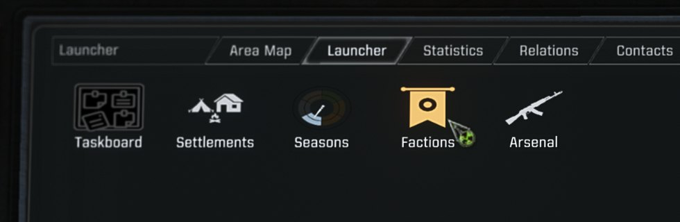

# Factions of the Zone

**The Zone's factions as living powers.** They hold ground, grow or bleed, make war and truces,
and talk about it on the PDA. You can stand with one, broker between them, or stay out of it.

A mod for the S.T.A.L.K.E.R. Anomaly modpack G.A.M.M.A. (Anomaly 1.5.3 with Modded Exes), a
sibling to [Seasons of the Zone](https://github.com/devinhorowitz/seasonsofthezone) and
[Arsenal](https://github.com/devinhorowitz/GAMMA-Arsenal-App). A Warfare lite for the story game:
the factions fight over the Zone around your story, not instead of it.



## Status

0.4.1 is the latest release, and work goes on. The plan is in [docs/DESIGN.md](docs/DESIGN.md).

## How it plays

**Watch the Zone shift.** Once a game day the factions' fights move their relations: kills, ground
taken, the fronts they share, a common enemy. Wars, truces and alliances come out of it, each one
news on your PDA in the faction's own voice. The Factions page says where the fighting is and who
is winning, and the PDA map marks each fight.



**Take a side.** Your kills count like anyone's. Fight beside a faction and its enemies remember
it; help a side win a front and its squads lean toward that front.

**Found your own faction.** Name it in MCM. It starts with your old faction's friends and enemies,
your companions join it, and from then on it goes to war, makes truces and finds allies in its own
name, moved by your kills and your members'.



**Fly your colors.** Sidorovich and every faction's own traders have your faction's patches sewn
to order, so whatever faction you came from, someone will sell you them. Your members wear them
and leave one behind when they fall, and with Wearable Devices you wear one on your bracer. The
art is a placeholder, there to be replaced: your own image makes the faction yours.



### Coming next

- **Settlers who earn their place** (0.5.0, with Homestead): loyalty that grows as you look after
  a camp. At 70 a settler asks to join your faction; at the top they're sworn for life, follow you
  to another camp if theirs falls, and lift the loyalty of the camp around them.
- **Invasions:** factions pushing into each other's ground, not only leaning toward it.
- **Other custom factions**, beside your own.

## Features

**Your own faction** (0.3.0, first part). Today you're a loner tied to one faction and its
alliances. In MCM you can found a faction of your own and name it. It's a real faction to the game:
it starts with the friends and enemies of the faction you came from, you lead it from your old
faction (keeping its traders and tasks; you can choose to join it instead), and your companions
join it. Disband it and everyone goes back to their old faction.

**Your faction's patch.** Traders have patches sewn for the faction you lead: ask, and buy as many
as you like, 650 RU apiece. Sidorovich does, and so do each faction's own traders at the bases its
players start from, so a trader will deal with you whatever faction you came from:

| Faction | Traders |
|---|---|
| Loners | Sidorovich (Cordon), Owl (Zaton) |
| Military | Sergeant Spooner (Agroprom), Major Zhurov (Cordon) |
| Bandits | Olivius (Dark Valley), Klenov (Jupiter), the trader at the Truck Cemetery |
| Clear Sky | Spore (Great Swamps) |
| Duty | Colonel Petrenko (Rostok) |
| Ecologists | Professor Sakharov (Yantar), Professor Hermann (Jupiter) |
| Freedom | Skinflint (Army Warehouses), Ashot (Jupiter) |
| Mercenaries | Dushman (Dead City), Vector (Zaton), Meeker (Pripyat) |
| Monolith | Krolik and Olivar (Pripyat), the trader at the Jupiter depot |
| Sin | Stribog (Red Forest) |
| ISG | Major Hernandez (Jupiter) |

The Renegades have no trader; the Bandits', who are friendly to them, take their orders. Your
members wear the patch and leave one behind when they fall, and it's your faction's emblem on the
Factions page. The art is a placeholder, an oval patch with this mod's banner, there to be
replaced: [docs/CUSTOM-PATCH.md](docs/CUSTOM-PATCH.md) shows how to put your own emblem on the
patch, the page and Wearable Devices' bracer, with a tool that makes the files from one picture.



**Politics.** Kills between two factions, ground one takes from the other, fronts where both are
fighting, and a common enemy push each pair's relation. Once a game day the push moves it, within a
daily limit, and old grudges fade. When a pair crosses into enmity, they go to war; after quiet
days, a truce; when a common enemy brings two factions close, an alliance. Each is news on your
PDA in the faction's own voice. Monolith, Sin, ISG, Renegades and the base game's lore pairs (Duty
and Freedom, the Military and the Loners, and others) never change, and every other pair has
limits. The faction you lead is a side too: its members' kills and yours move its relations, and
it goes to war and makes peace in its own name. It steps aside while the base game's dynamic
relations, Fluid Relations, Dynamic Faction Relations Customizer, or Warfare mode handle relations.

**Territory.** Factions at war lean toward the fronts they're winning. When a squad picks where to
go next, ground held by an enemy weighs more where its faction outnumbers that enemy on the level,
and less where it's outnumbered. It's only a bias in the game's own choice: nothing is ordered or
spawned, and story squads, squads on a scripted errand, your companions and Homestead's garrisons
are left alone. The Factions page says where the fighting is and who is winning, a level a
line; a side that takes the upper hand on a front says so on your PDA; and the PDA map marks each
fight with its two sides' names, red where it's your side's, amber elsewhere. Hover a marker for
who is winning there and which factions there are hostile to you.

**The Factions page.** Your side (the faction you lead, or your own) and, in words, how each
faction whose relation with it can change stands with you, what holds it there (a war, a truce, an
alliance), whether it's getting better or worse, and its leader; the factions that never change,
a line for each standing ("Permanent enemies: ..."); the war log; where the fighting is; your
members; a button to the PDA's own Relations tab, which has the numbers; and Reset relations,
which puts every relation back where it was before the fighting moved it and ends every war, truce
and alliance (a second click does it).

Open it your way: from a PDA tab of its own, from its tile in Mod App Creator's launcher, or with a
key that opens it in a window of its own (sharper than the 3D PDA). Mod App Creator is optional:
without it the page has its tab; with it, the tile, or the tab if you choose it in MCM. The key
works either way.



MCM, under Factions of the Zone: your faction (found or disband it, its name, whether you join it
yourself, off unless you choose it, and whether companions join), politics on or off, the
territory steer, the fighting on the PDA map, PDA news (off, wars and truces, or everything), the
census log, removing your faction's patches (before you remove the mod), the Factions page key,
and, with Mod App Creator, the page's own PDA tab.

**What it saves, and removing it.** Two keys in your save: each pair's change from where the game
started it, and your faction's roster. No character in a save is ever in your faction: just before
each save, everyone is put back in their old faction in the save itself, and gets your faction
back as you play on. Anyone another mod put in your faction is saved in your old one too, and
Homestead's camp records get your old faction in place of it. So removing the mod is safe: a save
loads with every faction's relations as the game had them and everyone in their old faction. The one
step first is for your faction's patches, which are items: a save that holds one can't load without
the mod, so set MCM's "Remove your faction's patches" and save before you remove it.

**Census.** Once a game day, and once after each load, it counts every faction's squads and
fighters by tier, rank and level, which faction holds each smart terrain and which are contested,
and the relations between the factions and toward you. With its log on, each census is one line
in `fotz_census.jsonl` in the game's appdata folder (`<Anomaly>\appdata`).
`_tools/census_report.py` reads that file and prints the latest census and each day's changes:

```
python _tools/census_report.py "<Anomaly>\appdata\fotz_census.jsonl"
```

## For other mods

The territory steer only weighs squads the game routes itself, so squads a mod directs (by a
scripted target or its own `get_script_target`) are never touched. A mod that holds squads without
one, such as a garrison kept at its post by its stay time, can claim them, and the steer leaves them
alone:

```lua
if fotz_territory and fotz_territory.add_owner then
    fotz_territory.add_owner("my_mod", function(squad) return my_mod.holds(squad.id) end)
end
```

Squads claimed in AlifePlus's owner registry (`ap_api.register_owner`), the squads Homestead
holds, and Capture the Zone's campaign squads are left alone too.

## Install

With Claude Code, see [INSTALL-WITH-CLAUDE.md](INSTALL-WITH-CLAUDE.md). By hand: put the
`gamedata` folder in a new MO2 mod and enable it anywhere in the list. It ships only files of its
own (`fotz_*`), so its position doesn't matter. Uninstall by disabling it, after taking your
faction's patches out of the game (above).

## Development

- `_tools/build.py` writes the Russian string tables, compiles every script under LuaJIT 2.0, runs
  the tests, and installs into an MO2 mods folder (`--check` only checks).
- `_tools/test_census.py` runs the census against a made-up alife, `test_politics.py` runs the
  politics engine through wars, truces, alliances, saves and stand-downs, `test_faction.py` runs
  your faction through founding, saves (byte-level packets), loads, disguise and disbanding,
  `test_tab.py` checks what the Factions page shows on top of the real politics engine and the
  ways in, `test_territory.py` runs the territory steer against a stand-in for the game's target
  scoring, `test_map.py` runs the fighting on the PDA map against a stand-in for its spots,
  `test_patch.py` runs your faction's patch and Sidorovich's dialog against a stand-in for the
  actor and his talk, and `test_text.py` checks the Russian tables' build.
- `_tools/mutants.py` runs each test against broken copies of what it tests (260 so far); every
  one must fail.
- `_tools/make_tile.py` and `_tools/make_art.py` draw the mod's own art: the launcher tile, the
  page's lines, your faction's placeholder patch, and the templates in `docs/custom-patch/`.
  `_tools/make_patch.py` makes a player's own patch from one picture
  ([docs/CUSTOM-PATCH.md](docs/CUSTOM-PATCH.md)).
- `_tools/release.py` packages a release: `build/FactionsOfTheZone-<version>.zip`, after
  `build.py --check` passes and only once CHANGELOG.md has a section for the version.
- Russian text lives in `_tools/lang/ru.po`, keyed by string id.

## Credits

- Capture the Zone, by Queen Jadwiga: its design shaped Factions' territory, and Factions leaves
  its campaign squads alone. Any code taken from it is used with her blessing and credited where
  it's used.

## License

MIT. By Devin Horowitz.
